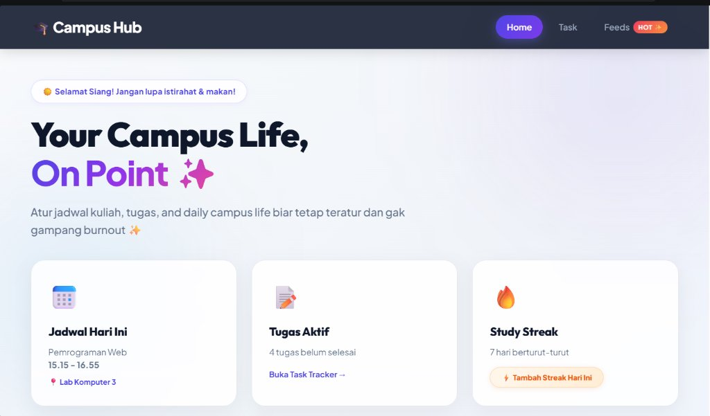
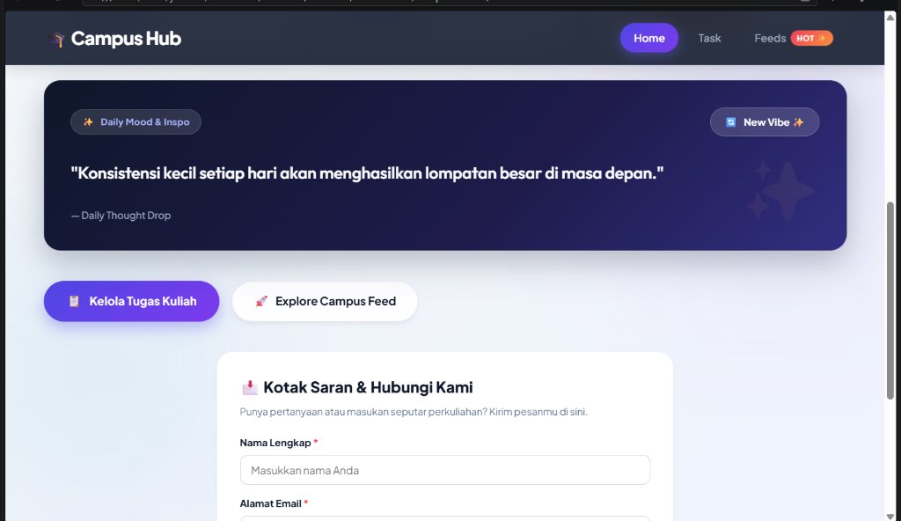
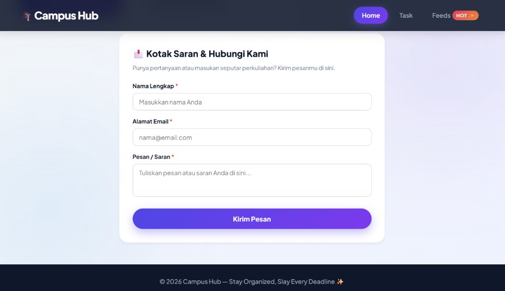
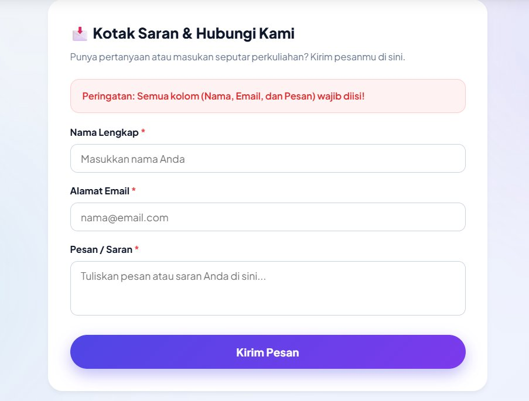
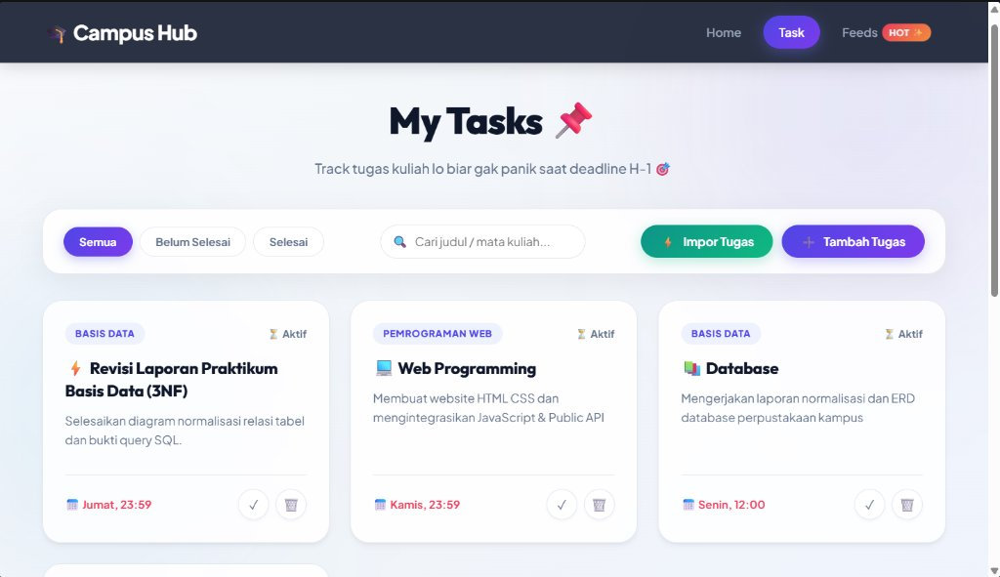
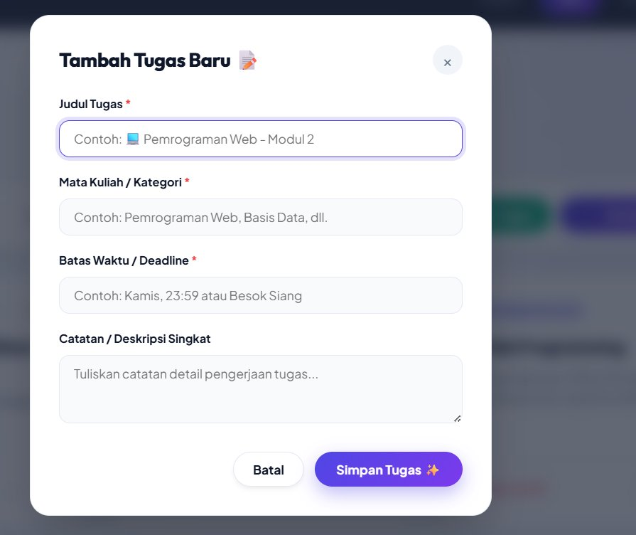
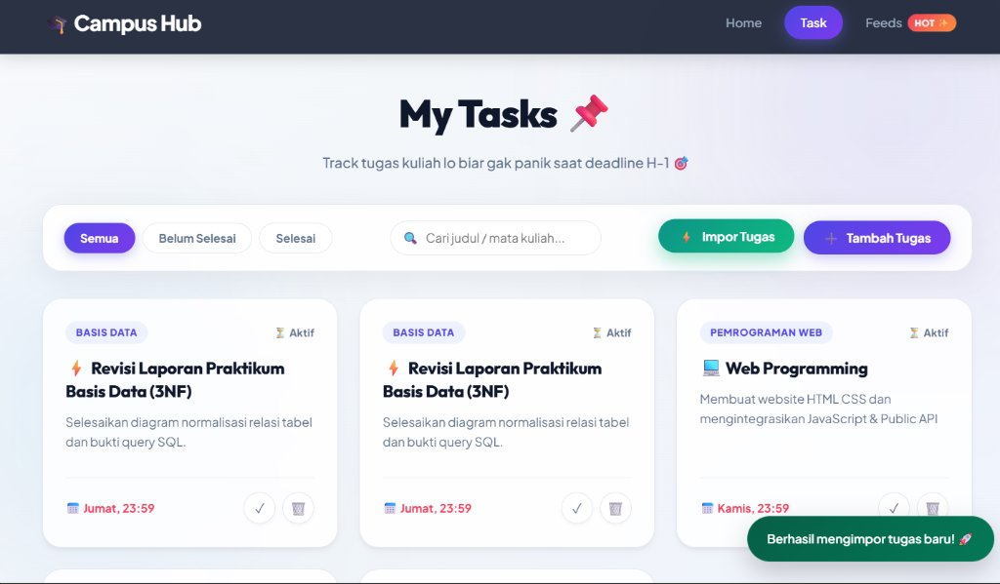
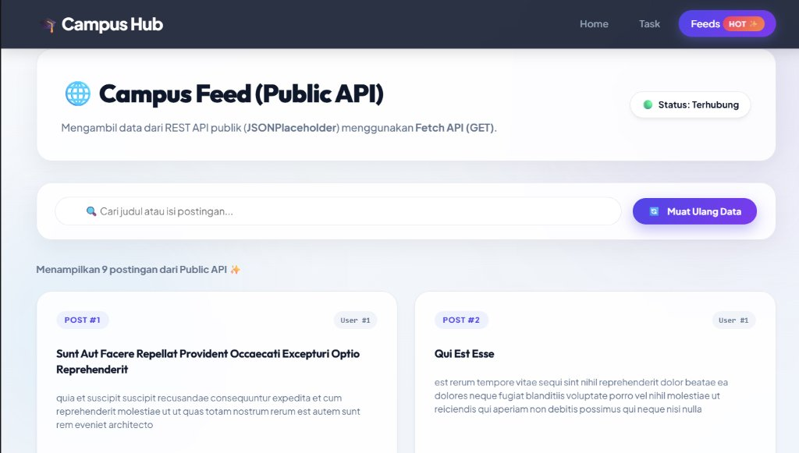

# 🎓 Campus Hub — Stay Organized, Slay Every Deadline ✨

Website platform mahasiswa modern yang dirancang untuk membantu mengatur jadwal perkuliahan, melacak dan memanajemen tugas harian (*Task Tracker*) dengan penyimpanan lokal (*localStorage*), serta mengeksplorasi pengumuman/feed kampus secara *real-time* menggunakan integrasi Public REST API.

---

## 🚀 Fitur Utama & Penerapan Teknologi

### 1. 📄 Hypertext Markup Language (HTML5)
* Struktur semantik modern (`<header>`, `<nav>`, `<section>`, `<article>`, `<footer>`).
* Navigasi multi-halaman yang rapi:
  * `index.html`: Dashboard utama, jadwal kuliah hari ini, study streak, motivasi harian, dan formulir kritik/saran.
  * `task.html`: Halaman manajemen tugas lengkap dengan modal dialog penambahan tugas.
  * `api.html`: Halaman penjelajah data *Campus Feed* dari Public API.
* Elemen formulir lengkap dengan atribut aksesibilitas, *placeholder*, serta validasi input.

### 2. 🎨 Cascading Style Sheets (CSS3)
* **Desain Modern & Responsif**: Menggunakan kombinasi CSS Grid dan Flexbox agar nyaman diakses dari layar laptop maupun smartphone (*mobile-friendly*).
* **CSS Custom Variables**: Penggunaan skema warna gradasi modern, bayangan halus (*box-shadow*), dan tipografi yang nyaman dibaca.
* **Komponen & Efek Interaktif**: Animasi kartu saat di-*hover*, status badge dinamis, modal backdrop blur, serta indikator *loading spinner*.

### 3. ⚡ JavaScript (ES6+)
* **Manipulasi DOM Real-time**: Render elemen kartu secara dinamis langsung dari array objek data.
* **Interaktivitas Pengguna**:
  * *Study Streak Counter*: Pencatat kebiasaan belajar harian yang tersimpan di `localStorage`.
  * *Daily Mood & Inspo*: Penggantian kutipan motivasi kampus secara acak.
  * *Task Tracker*: Menambah tugas baru, menandai selesai (checklist), filter tugas (*Semua*, *Belum Selesai*, *Selesai*), pencarian *live search*, dan hapus tugas.
  * *Form Validation*: Pengecekan kolom kosong dan validitas format email dengan notifikasi peringatan visual.
  * *Toast Notification*: Notifikasi pop-up dinamis saat aksi tertentu berhasil dilakukan (misalnya impor tugas atau penambahan streak).

### 4. 🌐 Public REST API
* Mengambil data secara *asynchronous* menggunakan metode `fetch()` (HTTP GET) dari endpoint REST API publik:
  ```text
  https://jsonplaceholder.typicode.com/posts?_limit=9
  ```
* Menggunakan sintaks modern `async/await` dengan blok pengaman `try...catch`.
* **State Handling Komprehensif**:
  * **Loading State**: Menampilkan indikator putar (*spinner*) saat data sedang diambil dari server.
  * **Error Handling**: Menampilkan kartu peringatan ramah pengguna jika jaringan terputus atau server gagal merespons, lengkap dengan tombol coba lagi (*retry*).
  * **Success State**: Menampilkan data hasil respons API ke dalam kartu-kartu *feed* informatif.
* **Fitur Pencarian Client-Side**: Memfilter judul dan isi postingan API secara langsung saat pengguna mengetik kata kunci.

---

## 📁 Struktur Direktori Proyek

```text
Campus hub/
│
├── index.html           # Halaman Dashboard Beranda
├── task.html            # Halaman Task Tracker & Manajemen Tugas
├── api.html             # Halaman Eksplorasi Public API (Campus Feed)
├── style.css            # Styling & Tema Utama Website
├── script.js            # Logika JavaScript Halaman Beranda (Streak, Quote, Validasi)
├── task.js              # Logika CRUD & Filter Task Tracker (LocalStorage)
├── api.js               # Logika Integrasi Fetch Public REST API & Live Search
├── posts.json           # Data cadangan postingan lokal (JSON format)
│
├── screenshots/         # Dokumentasi tangkapan layar tampilan website
│   ├── 01-home-hero.jpg
│   ├── 02-home-quote.jpg
│   ├── 03-home-contact.jpg
│   ├── 04-home-validation.jpg
│   ├── 05-task-tracker.jpg
│   ├── 06-task-modal.jpg
│   ├── 07-task-import.jpg
│   └── 08-api-feed.jpg
│
└── README.md            # Dokumentasi lengkap proyek
```

---

## 📸 Dokumentasi Tangkapan Layar (Screenshots)

### 1. Halaman Beranda (`index.html`)

#### A. Hero Section & Ringkasan Aktivitas Kuliah
Menampilkan sapaan waktu otomatis, kartu jadwal kuliah hari ini, jumlah tugas aktif, dan fitur *Study Streak*.


#### B. Daily Mood & Inspo Motivasi
Kutipan inspirasi belajar yang dapat diperbarui secara acak dengan satu kali klik.


#### C. Formulir Kotak Saran & Hubungi Kami
Formulir kontak untuk kritik dan saran mahasiswa.


#### D. Validasi Formulir Interaktif (JavaScript)
Peringatan otomatis muncul jika ada kolom yang belum diisi atau format email tidak sesuai.


---

### 2. Halaman Task Tracker (`task.html`)

#### A. Manajemen & Filter Status Tugas Kuliah
Daftar kartu tugas dinamis lengkap dengan tombol filter status (*Semua, Belum Selesai, Selesai*), pencarian *live search*, dan tanggal *deadline*.


#### B. Modal Dialog Tambah Tugas Baru
Popup formulir interaktif untuk memasukkan judul tugas, kategori mata kuliah, batas waktu, dan deskripsi pengerjaan.


#### C. Fitur Impor Tugas & Notifikasi Toast
Fitur cepat untuk mengimpor contoh tugas kuliah disertai notifikasi *toast* mengambang di pojok kanan bawah.


---

### 3. Halaman Campus Feed / Public API (`api.html`)

#### A. Integrasi Public REST API & Pencarian Real-Time
Mengambil data secara langsung dari Public API (`JSONPlaceholder`) menggunakan `fetch()`, menampilkan status koneksi hijau, tombol muat ulang data, dan fitur pencarian postingan langsung.


---
